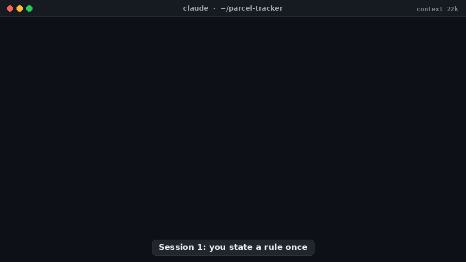
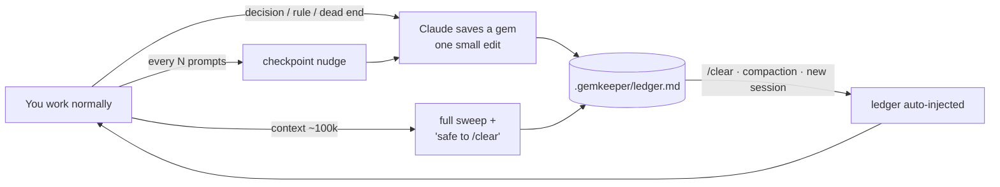

<p align="center">
  
</p>

<h1 align="center">gemkeeper</h1>

<p align="center">
  <b>Never kill a good Claude Code session again.</b><br>
  Claude writes down the 2% of context that matters <i>while it still remembers it</i>,<br>
  so you can <code>/clear</code> a bloated session and keep going at full quality.
</p>

<p align="center">
  <a href="#install">Install</a> ·
  <a href="#how-it-works">How it works</a> ·
  <a href="examples/ledger.example.md">Example ledger</a> ·
  <a href="#faq">FAQ</a>
</p>

<!-- TODO before launch: record a 15–20s GIF (long session → /gems → /clear → new session picks up instantly),
     save it as docs/demo.gif and uncomment the next line.
<p align="center"></p>
-->

---

## The problem

You finally have a session where Claude *gets it*. It knows the weird test setup, why you
picked SQLite, the three approaches that already failed. Then the context fills up and you have two bad options:

- **Keep going.** Quality drifts as the window bloats. Old instructions fade.
- **`/clear` or let it auto-compact.** The summary keeps the broad picture and quietly drops the
  *why*, the dead ends, and the one rule you said 80 messages ago.

Handoff skills help, but they run **at the end**, when the context is already at its biggest and the
details are already blurred.

## The fix: a ledger that's written continuously

gemkeeper keeps one short file, `.gemkeeper/ledger.md`, that Claude updates **as things happen**:

| Section | What goes in |
|---|---|
| **Mission** | The goal and what "done" means |
| **Rules** | Hard constraints and your stated preferences, marked `(user)` |
| **Decisions** | What was decided **and why**, so the next session doesn't reverse it |
| **Dead ends** | What was tried and why it failed, so nobody wastes an hour retrying it |
| **Facts** | Env quirks, the exact command that works, the misleading error |
| **Now** | Current state and the single next step |

Every entry has to pass one test: *would a fresh session with only the code and this ledger get this wrong?*
If not, it stays out. That keeps the ledger at around 1–2k tokens instead of turning into another dump.
→ [See a real-looking example](examples/ledger.example.md)

## How it works



- **Skill `gems`.** Teaches Claude what counts as a gem, the format, and four modes: capture, sweep, resume, close.
- **SessionStart hook.** Re-injects the ledger after `/clear`, after auto-compaction, and on a new session.
  After compaction it tells Claude the ledger outranks the lossy summary.
- **UserPromptSubmit hook.** A one-line checkpoint every 6 prompts, plus a single warning when the
  context passes ~100k tokens (read from the real API usage in the transcript).
- **PreCompact hook.** Tells the compactor not to waste summary space on what the ledger already holds.

Plain bash. No dependencies, no network, no telemetry.

## Install

**As a plugin (recommended: skill + hooks):**

```
/plugin marketplace add adamoelz/gemkeeper
/plugin install gemkeeper@gemkeeper
```

**Skill only (no automatic re-injection, works with any agent that supports skills):**

```bash
npx skills add adamoelz/gemkeeper
```

**Manual:**

```bash
git clone https://github.com/adamoelz/gemkeeper && cd gemkeeper
./install.sh --hooks   # installs the skill + merges hooks into ~/.claude/settings.json (backup made)
```

## Usage

Mostly: nothing. Work as usual and Claude captures gems on its own. When you want to reset:

```
/gems          # full sweep → "Safe to /clear"   (as a plugin: /gemkeeper:gems)
/clear         # fresh context, ledger is injected automatically
```

Claude then replies with three lines (mission, where we are, next step) and continues.

| You say | What happens |
|---|---|
| `/gems` or "sweep" | Full pass: capture missed gems, verify against git, rewrite `## Now`, prune |
| "resume" | Restate mission / state / next step from the ledger and check it against git |
| "close the ledger" | Archive it to `.gemkeeper/archive/` and start fresh for the next mission |

## Configuration

Plugin users: `/plugin` → gemkeeper → configure. Manual install: environment variables.

| Option | Env var | Default | |
|---|---|---|---|
| `nudge_every` | `GEMKEEPER_NUDGE_EVERY` | `6` | Checkpoint every N prompts (`0` = off) |
| `warn_tokens` | `GEMKEEPER_WARN_TOKENS` | `100000` | Sweep warning threshold (`0` = off) |
| | `GEMKEEPER_LEDGER` | `.gemkeeper/ledger.md` | Ledger path |
| | `GEMKEEPER_MAX_INJECT_LINES` | `250` | Safety cap on what gets injected |

## How is this different from…

| | Built-in `/compact` | Handoff skills | **gemkeeper** |
|---|---|---|---|
| When context is captured | At compaction | At the end of the session | **Continuously, while details are fresh** |
| Keeps the *why* and dead ends | Often lost | Depends on the prompt | **First-class sections** |
| Survives auto-compaction | n/a | Only if you ran it in time | **Re-injected automatically** |
| Stays small | Yes | Often grows big | **Ledger test + ~120-line cap** |
| Manual step needed | No | Yes (copy/paste or command) | **No** |

Works well *alongside* `/compact` and CLAUDE.md: CLAUDE.md is for project-wide truths, the ledger is for the current mission.

## FAQ

**Should I commit `.gemkeeper/`?** Your call. Ignored by default (in `.gitignore`). Commit it if your team should share the context of a mission.

**Does it cost tokens?** A little: the ledger (~1–2k tokens) on reset, and ~50 tokens per checkpoint. In exchange you can reset much earlier and much more often.

**Parallel sessions in one repo?** v0.1 uses one ledger per project. Set `GEMKEEPER_LEDGER` per terminal if you run several missions in parallel.

**Windows?** Works in Git Bash, which Claude Code uses on Windows.

## Contributing

Issues and PRs are welcome, especially real-world "the ledger missed X" reports. They make the ledger test sharper.

If gemkeeper saved one of your sessions, a ⭐ helps other people find it.

## License

MIT
